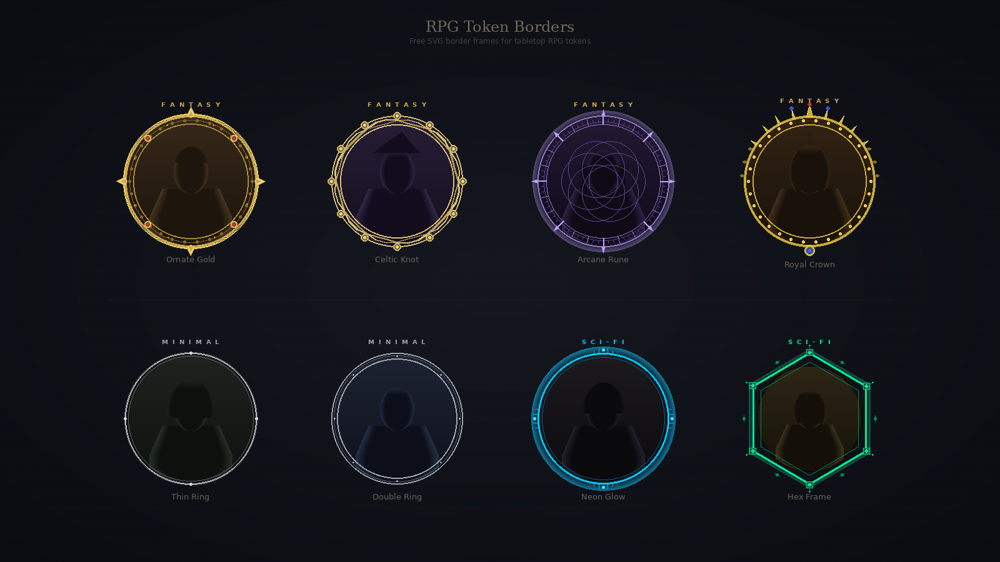

# RPG Token Borders

Free SVG border frames for tabletop RPG character tokens. Use them with any virtual tabletop — Roll20, Foundry VTT, Fantasy Grounds, Owlbear Rodeo, and more.

## Preview

| Fantasy | Minimal | Sci-Fi |
|---------|---------|--------|
| Classic gold rings, ornate frames | Clean circles, thin strokes | Neon rings, tech frames |

## What's Included

- **Fantasy** — 8 borders (ornate, royal, arcane, etc.)
- **Minimal** — 4 borders (clean, thin, modern)
- **Sci-Fi** — 3 borders (neon, tech, holographic)

All borders are:
- SVG format with `viewBox="0 0 512 512"`
- Transparent centers (ready for portrait overlay)
- Optimized for VTT grid sizes (280px–400px+)

## Usage

1. Download any SVG from the `borders/` folder
2. Overlay your character portrait in any image editor
3. Export as PNG/WebP at your VTT's recommended size

Or use them instantly with **[RPG Token Maker](https://rpgtokenmaker.com)** — a free browser-based tool that lets you batch-create VTT-ready tokens with these borders in seconds.

## Folder Structure
    borders/
    ├── fantasy/    # 8 ornate fantasy borders
    ├── minimal/    # 4 clean minimal borders
    └── scifi/      # 3 sci-fi themed borders

## License

The original SVG files in `borders/` are MIT — free for personal and commercial use.

The [sample artwork package](samples/README.md) has separate terms: Battle for Wesnoth portraits and our modified sample images are **GPL v2 or later**, with full license text, originals, pinned source links and reproduction notes in `samples/`. TheGreatNacho frame permissions are preserved separately in `samples/frames/LICENSE.md`.

## Links

- **[RPG Token Maker](https://rpgtokenmaker.com)** — Free online token maker
- **[DnD Token Maker](https://rpgtokenmaker.com/dnd-token-maker)** — D&D-specific token tool
- **[Creature Token Sizes Guide](https://rpgtokenmaker.com/guides/creature-token-sizes)** — Export size reference for D&D creatures
